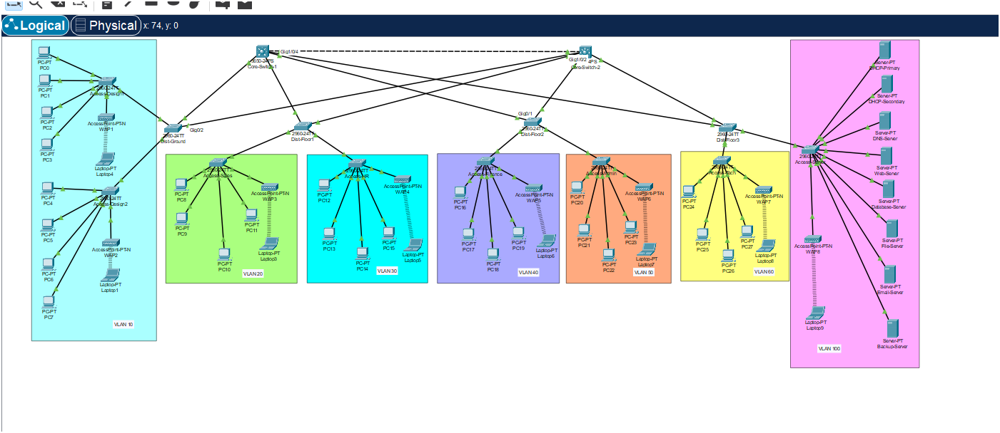

# Secured Hierarchical Network Solution – Four-Floor Office Building

A secure, redundant office network designed and simulated in **Cisco Packet Tracer 8.2.2**.

## Overview
- About 700 users across 6 departments on 4 floors, plus a 10-device server room
- Three-layer hierarchical model: Core, Distribution, Access
- Wireless access points in every department
- Devices get IP addresses automatically from DHCP servers in the server room; servers use static IPs

## Topology

## Floors and departments
| Floor | Departments | VLAN |
|---|---|---|
| Ground | Design and Development (200 users) | 10 |
| 1st | Sales and Marketing (100 users) | 20 |
| 1st | HR (100 users) | 30 |
| 2nd | Finance and Accounts (100 users) | 40 |
| 2nd | Administration (100 users) | 50 |
| 3rd | Technical Communication (100 users) | 60 |
| 3rd | Server Room (10 devices) | 100 |

Other VLANs: 99 Management, 200 Guest-Wireless.

## Design features
- **Redundancy:** two core switches; every distribution switch connects to both cores
- **HSRP:** Core-1 is the active gateway (priority 110), Core-2 is standby (priority 100). If Core-1 fails, Core-2 takes over automatically
- **VLANs:** a separate VLAN per department, server room, management and guest wireless
- **Inter-VLAN routing:** done on the core switches
- **DHCP:** primary and secondary DHCP servers in the server room
- **Security:** ACLs protect the server room and block guest wireless users from the internal network

## Files
- `PD_AI-Solutions_Network.pkt` – Packet Tracer project (open with Packet Tracer 8.2.2)
- `topology.png` – network diagram

## Author
Zainulabdeen Fathima Rukshana
